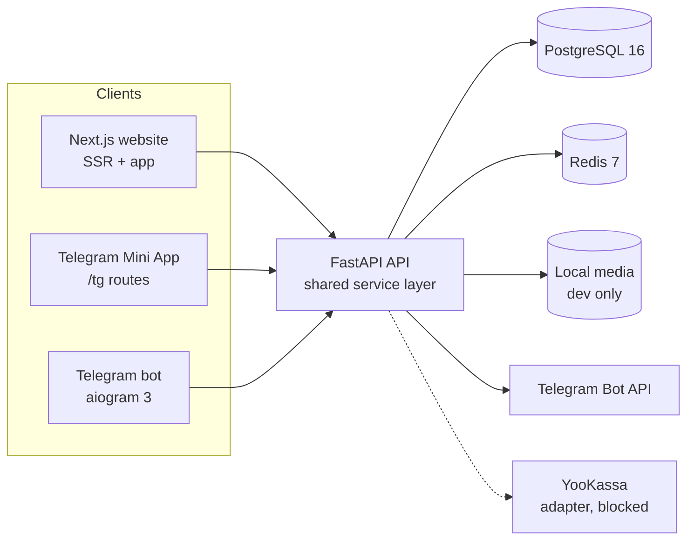



# Zooffer

[](https://github.com/devilnevecry/Zooffer_final/actions/workflows/ci.yml)
[](https://github.com/devilnevecry/Zooffer_final/tags)
[](LICENSE)

## Что это — и что это говорит обо мне как разработчике

Zooffer — русскоязычная платформа для поиска животных, размещения объявлений, взаимных совпадений и личной переписки. Один бэкенд на FastAPI обслуживает сайт на Next.js, Telegram-бота и Telegram Mini App.

Важнее того, что делает продукт — то, как он сделан. Это полноценный full-stack проект, который я спроектировал и реализовал целиком: от схемы базы данных и политики приватности до пользовательского интерфейса и конвейера CI/CD. Это не прототип на коленке — это проверенный код, который готов к продакшену после подключения внешних ключей.

**Что вы видите, глядя на этот репозиторий:**
- **Бэкенд на Python:** FastAPI, SQLAlchemy 2 (async), Alembic, PostgreSQL 16 — единая доменная модель для сайта, бота и Mini App.
- **Фронтенд:** Next.js 16 App Router, React 19, TypeScript, SSR для публичных страниц, общие дизайн-токены с Mini App.
- **Telegram-экосистема:** бот на aiogram 3 и Mini App, использующие одни и те же сервисы — без дублирования бизнес-логики.
- **Безопасность и приватность по умолчанию:** зашифрованные приватные данные, слепые индексы, allowlist DTO, защита от IDOR, HMAC-токены, CSRF, MFA для сотрудников.
- **Инженерная культура:** 74 теста бэкенда, чистые ruff / mypy / bandit / pip-audit / npm-audit / gitleaks, production-сборка Next.js, GitHub Actions CI.

---


## Что реализовано (и почему это сложно)

### Обнаружение и совпадения
Пять типов объявлений, полнотекстовый поиск, фильтры, ключовая пагинация, лента со свайпами и общая дневная квота для сайта, бота и Mini App. Совпадение создаётся только при взаимном лайке — внутри одной транзакции, без состояний и гонок.

### Объявления и профили животных
Мастер создания объявления с возможностью продолжения, профили животных, конвейер фотографий: проверка контента, лимиты размера, удаление EXIF, очередь модерации и обработка жалоб.

### Личная переписка
Диалог открывается только по явному запросу — не по лайку. Есть блокировки, жалобы, настройки уведомлений и тихие часы.

### Аккаунты и приватность
Вход по паролю и через Telegram, верификация и сброс почты, сессии с HMAC-хэшем токенов, защита CSRF, MFA для персонала, удаление аккаунта и экспорт данных.

### Админка
Модерация, жалобы, пользователи, тикеты поддержки, аудит-лог, настройки, заказы на оплату, возвраты, выдача прав. Каждый эндпоинт требует одновременно RBAC **и** верифицированную сессию MFA.

### Биллинг
Интерфейс `PaymentProvider` с детерминистичным фейковым провайдером для разработки, цены на сервере, подписанные вебхуки, идемпотентная обработка событий, отмена подписки и доступ до конца периода. YooKassa и Telegram Stars отключены до появления реальных ключей.

| Поиск | Объявление |
|---|---|
|  |  |

| Подписка | Админ-платежи | Mini App |
|---|---|---|
|  |  |  |

## Архитектура



Бот импортирует те же доменные сервисы, а не переизобретает правила; сайт и Mini App вызывают HTTP API. Весь авторитетный результат — в PostgreSQL. Клиенты не хранят важного состояния. Нет fallback на SQLite.

## Стек технологий (моя компетенция)

| Слой | Технологии |
|---|---|
| Бэкенд | Python 3.12, FastAPI 0.115, SQLAlchemy 2 (async), Alembic, PostgreSQL 16 |
| Кэш и лимиты | Redis 7 (с локальным fallback для одной dev-процесса) |
| Сайт и Mini App | Next.js 16 App Router, React 19, TypeScript, глобальный CSS |
| Бот | aiogram 3, подписанные колбэки, вебхук или long-polling |
| Тесты | pytest + httpx ASGI, отдельная тестовая база PostgreSQL |
| CI | GitHub Actions: ruff, mypy, pytest, tsc, ESLint, сборка, bandit, gitleaks |

## Структура проекта

```text
backend/   FastAPI приложение, SQLAlchemy модели, миграции Alembic, тесты
bot/       aiogram бот, подписанные колбэки, работник уведомлений
web/       Next.js сайт и /tg Mini App
docs/      архитектура, ADR, приватность, платежи, runbook, доказательства
infra/     скрипт инициализации PostgreSQL для локального Compose
scripts/   заполнение демо-данных, локальный CI, операционные утилиты
legacy/    справочные материалы только для чтения, в gitignore, не импортируются
```

## Доказательство качества (что запущено и проверено)

Локально проверено:

- **74 теста бэкенда проходят**, включая проверки утечки приватности и IDOR
- ruff и ruff-format чистые, mypy чистый на общем бэкенде
- bandit, `pip-audit` и `npm audit` чистые, gitleaks чистый
- Production-сборка Next.js со **56 маршрутами**
- Ручная QA при ширине экрана 390/1280 px

Полный проход CI через `scripts/ci.ps1`. Подробности — в [docs/TEST_REPORT.md](docs/TEST_REPORT.md), [docs/SECURITY_REPORT.md](docs/SECURITY_REPORT.md) и [docs/KNOWN_ISSUES.md](docs/KNOWN_ISSUES.md).

## Быстрый старт (Windows, локально)

1. Запустите PostgreSQL и Redis:
   ```powershell
   docker compose -f compose.dev.yaml up -d
   ```

2. Скопируйте `.env.example` в `.env` и задайте локальные секреты. `.env` в gitignore.

3. Установите зависимости и примените миграции:
   ```powershell
   .venv\Scripts\python -m pip install -e "backend[dev]"
   $env:PYTHONPATH='backend'
   .venv\Scripts\python -m alembic -c backend\alembic.ini upgrade head
   ```

4. Заполните демо-данные (по желанию):
   ```powershell
   $env:PYTHONPATH='backend'
   .venv\Scripts\python scripts\seed_dev.py
   ```
   Пароль демо: `ZoofferDemo2026!`. Аккаунты: `anna@example.com`, `mikhail@example.com` и другие.

5. Запустите API:
   ```powershell
   $env:PYTHONPATH='backend'
   .venv\Scripts\python -m uvicorn zooffer.main:app --host 127.0.0.1 --port 8000
   ```

6. Запустите сайт:
   ```powershell
   cd web
   npm install
   npm run dev
   ```
   Откройте <http://localhost:3000>. Mini App — в разделе `/tg`.

7. Бот (по желанию, нужен `TELEGRAM_BOT_TOKEN`):
   ```powershell
   $env:PYTHONPATH='backend;bot'
   $env:BOT_MODE='polling'
   .venv\Scripts\python -m zooffer_bot
   ```

## Приватность и безопасность (сделано осознанно)

- Сессии в HttpOnly-куки, токены с HMAC-SHA256, ротация при смене привилегий, отзыв по устройствам.
- CSRF double-submit + проверка Origin; защита от IDOR на каждом приватном ресурсе.
- Приватные данные — в отдельной зашифрованной таблице со слепым индексом; публичные DTO — по allowlist; canary-тесты на утечки.
- Валидация загрузок, перекодирование и серверные имена файлов.
- RBAC для персонала + обязательная сессия MFA; аудит-лог админских действий.
- Вебхуки оплат проверяются, защищены от повторов и сверяются по сумме.

Подробнее: [docs/PRIVACY_MODEL.md](docs/PRIVACY_MODEL.md) · [docs/THREAT_MODEL.md](docs/THREAT_MODEL.md) · [docs/SECURITY_REPORT.md](docs/SECURITY_REPORT.md).

## Статус реализации

| Направление | Статус | Где проверить |
|---|---|---|
| Доменная модель, API, приватность | ✅ Проверено | 74 pytest-теста, включая privacy canaries и IDOR |
| Сайт, личный кабинет, админ UI | ✅ Проверено | typecheck, lint, production-сборка, QA 390/1280 px |
| Экраны Mini App | ⚠️ Реализовано, не проверено вживую | `/tg/*` рендерится локально; нужен токен бота |
| Логика бота и уведомления | ⚠️ Реализовано, не проверено вживую | `test_bot.py` с фейками; нужен B2 |
| Демо-биллинг (фейковый провайдер) | ✅ Проверено | `test_payments.py`; чек-аут → активация → возврат |
| YooKassa | ⚠️ Код есть | нет sandbox-ключей (B4) |
| Telegram Stars | 🔒 Заблокировано | нет бота/merchant (B5) |
| Почта | 🔒 Заблокировано | нет SMTP (B6); локально консольный адаптер |
| Продакшен-хостинг и медиа-хранилище | 🔒 Заблокировано | нет хоста/домена (B7), объектного хранилища (B9) |
| E2e и нагрузочные тесты | ⏳ Не начато | ручная QA; нет нагрузочного теста квоты |

Актуальная таблица — в [docs/REQUIREMENTS_TRACEABILITY.md](docs/REQUIREMENTS_TRACEABILITY.md).

## Платежи

Демо-оформление заказа работает только при `PAYMENT_PROVIDER=fake` и окружении `dev`/`test`; интерфейс помечает его как имитацию, денег не перечисляется. Бот и Mini App не предлагают оплату картами — Telegram Stars не подключён. См. [docs/PAYMENTS.md](docs/PAYMENTS.md).

## Документация

Начните с [docs/README.md](docs/README.md). Главное:
- [Архитектура](docs/ARCHITECTURE.md) · [ADR и решения](docs/DECISIONS.md)
- [Модель приватности](docs/PRIVACY_MODEL.md) · [Модель угроз](docs/THREAT_MODEL.md)
- [Платежи](docs/PAYMENTS.md) · [Интеграция с Telegram](docs/TELEGRAM.md)
- [Отчёт безопасности](docs/SECURITY_REPORT.md) · [Отчёт тестирования](docs/TEST_REPORT.md)
- [Runbook](docs/RUNBOOK.md) · [Блокировки](docs/BLOCKERS.md) · [Известные проблемы](docs/KNOWN_ISSUES.md)
- [Вклад в проект](CONTRIBUTING.md) · [Политика безопасности](SECURITY.md) · [История изменений](CHANGELOG.md)

## Лицензия и право

Проприетарный проект, все права защищены — см. [LICENSE](LICENSE). Юридические шаблоны в [docs/legal](docs/legal) требуют проверки квалифицированным российским юристом. Реквизиты оператора — заглушки, пока владелец не предоставит реальные данные (B8).

---

Сделано с акцентом на чистый код, приватность и надёжность. Если ищете разработчика, который берёт на себя продукт целиком — от базы данных до интерфейса и CI/CD — этот проект тому доказательство.
