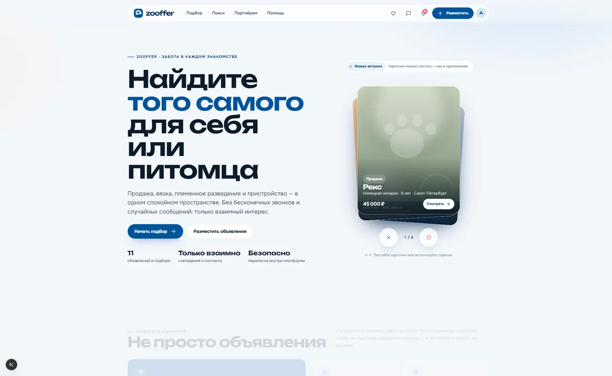
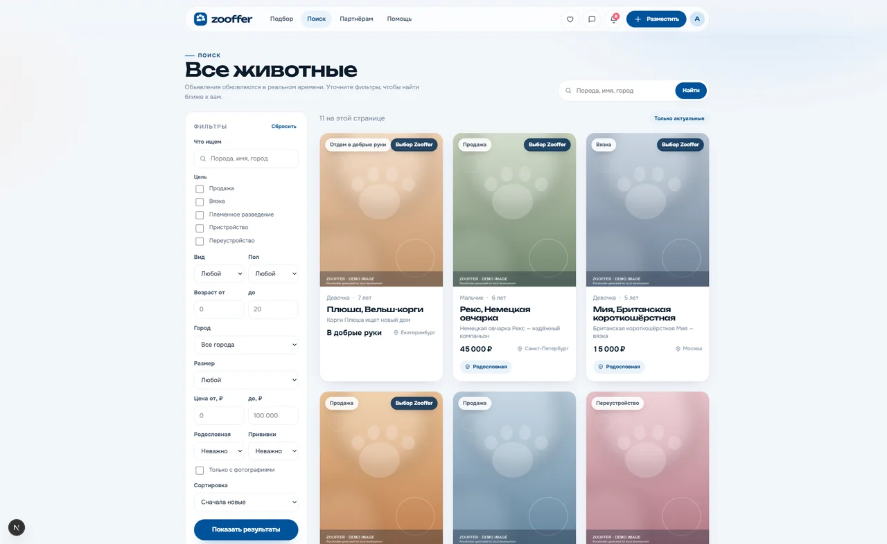
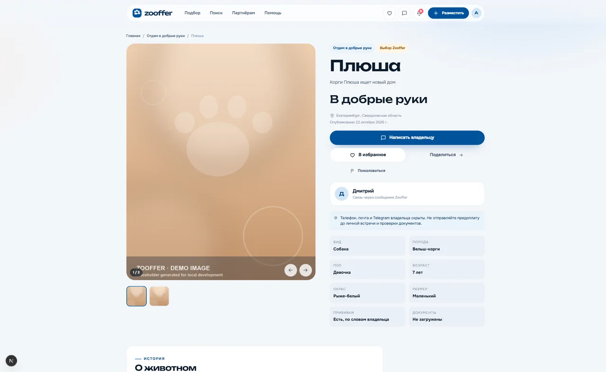
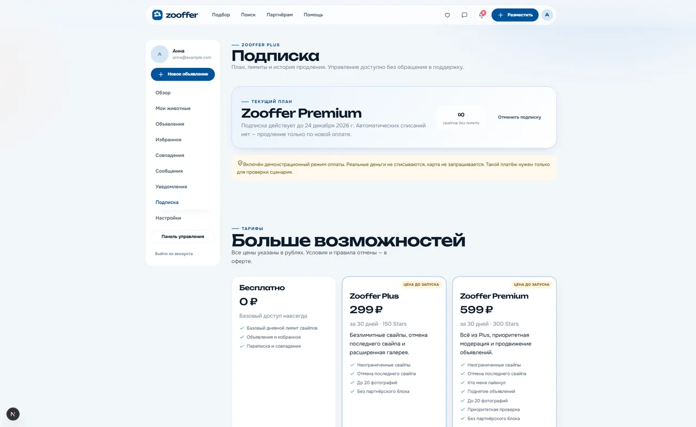
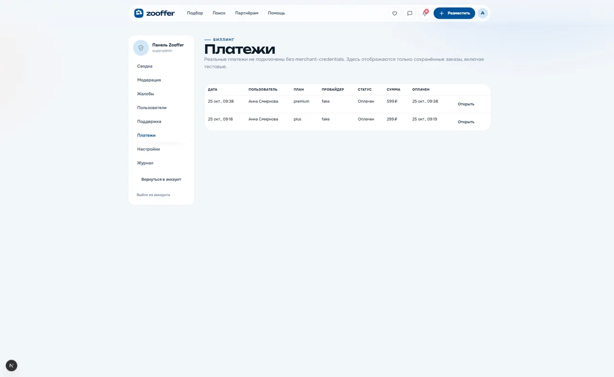
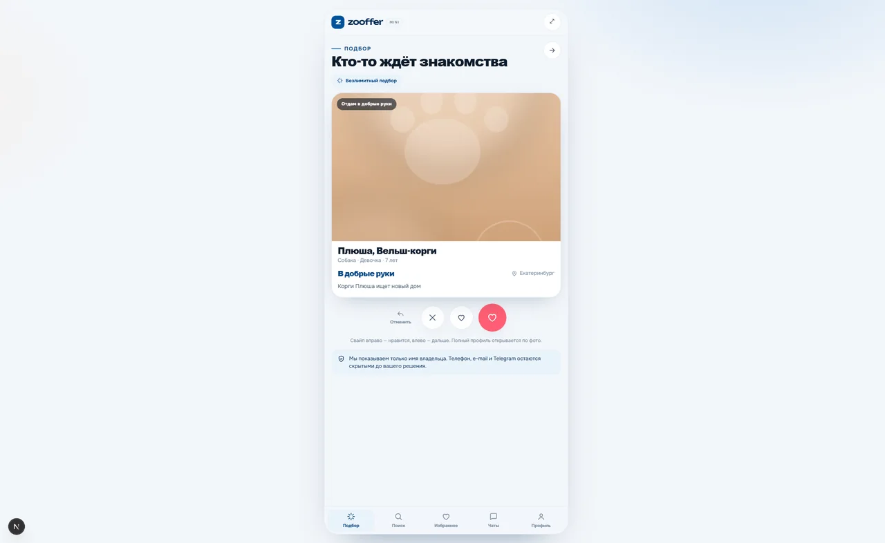
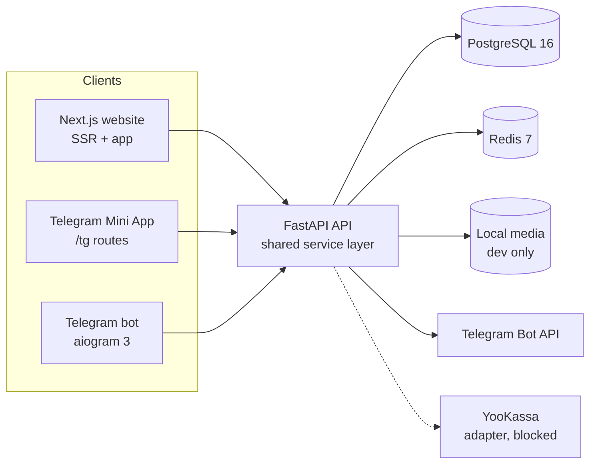

# Zooffer

[](https://github.com/devilnevecry/Zooffer_final/actions/workflows/ci.yml)
[](https://github.com/devilnevecry/Zooffer_final/tags)
[](LICENSE)

Zooffer is a Russian-language platform for finding animals, publishing listings, mutual matching and
private messaging. One FastAPI backend serves a Next.js website, a Telegram bot and a Telegram Mini
App. Privacy is enforced by the schema: other people see a public first name, an optional surname or
«Владелец» — never contacts, internal IDs, Telegram IDs/usernames, photos or online status.

This is a **local-first build**. Everything listed as verified runs against PostgreSQL and is covered
by tests or a documented manual check. Live Telegram, real payments, e-mail delivery, object storage
and production hosting need credentials or infrastructure and are tracked as blockers — nothing is
claimed that was not run.



## What works

- **Discovery and matching** — five listing purposes, full-text search, filters, keyset pagination,
  swipe feed and a server-enforced daily quota shared by the website, bot and Mini App. Matches are
  created only on mutual likes inside one transaction.
- **Listings and animals** — a resumable listing wizard, animal profiles, photo pipeline with
  content sniffing, size limits and EXIF stripping, moderation queue and report handling.
- **Messaging** — conversations open from an explicit inquiry (not from a like), with blocks,
  reports, notification preferences and quiet hours.
- **Accounts and privacy** — password and Telegram login, e-mail verification and reset, sessions with
  HMAC-hashed tokens, CSRF defence, MFA for staff, account deletion, data export.
- **Admin** — moderation, reports, users, support tickets, audit log, settings, payment orders,
  refunds, entitlement grants and reconciliation; every endpoint requires RBAC **and** a
  verified MFA session.
- **Billing** — a `PaymentProvider` interface with a deterministic fake provider for development,
  server-priced orders, signed webhooks, idempotent event processing, subscription cancellation and
  period-end access. YooKassa and Telegram Stars stay blocked.
- **Website and Mini App** — Next.js App Router with SSR for public pages, an account area, and a
  `/tg` Mini App that reuses the same API and design tokens.

| Search | Listing |
|---|---|
|  |  |

| Subscription | Admin payments | Mini App |
|---|---|---|
|  |  |  |

## Architecture



The bot imports the same domain services instead of re-implementing rules; the website and Mini App
call the HTTP API. All state lives in PostgreSQL; clients hold no authoritative state. There is no
SQLite fallback. See [docs/ARCHITECTURE.md](docs/ARCHITECTURE.md).

## Stack

| Layer | Technology |
|---|---|
| Backend | Python 3.12, FastAPI 0.115, SQLAlchemy 2 (async), Alembic, PostgreSQL 16 |
| Cache / rate limits | Redis 7 (in-process fallback for a single dev process) |
| Web + Mini App | Next.js 16 App Router, React 19, TypeScript, plain global CSS |
| Bot | aiogram 3, signed callback payloads, webhook or polling |
| Tests | pytest + httpx ASGI transport, PostgreSQL test database |
| CI | GitHub Actions: ruff, mypy, pytest, tsc, ESLint, build, bandit, gitleaks |

## Project structure

```text
backend/            FastAPI app, SQLAlchemy models, Alembic migrations, tests
bot/                aiogram bot, signed callbacks, notification worker
web/                Next.js website and /tg Mini App
docs/               architecture, ADRs, privacy, payments, runbook, evidence
infra/              PostgreSQL init script for local Compose
scripts/            demo seed, local CI launcher, operational helpers
legacy/             read-only reference material, git-ignored, never imported
```

## Quick start (Windows, local)

1. Start PostgreSQL and Redis:

   ```powershell
   docker compose -f compose.dev.yaml up -d
   ```

2. Copy `.env.example` to `.env` and set development-only secrets. `.env` is git-ignored.

3. Install dependencies and migrate:

   ```powershell
   .venv\Scripts\python -m pip install -e "backend[dev]"
   $env:PYTHONPATH='backend'
   .venv\Scripts\python -m alembic -c backend\alembic.ini upgrade head
   ```

4. Seed demo data (optional):

   ```powershell
   $env:PYTHONPATH='backend'
   .venv\Scripts\python scripts\seed_dev.py
   ```

   Demo password: `ZoofferDemo2026!`. Accounts: `anna@example.com`, `mikhail@example.com`,
   `elena@example.com`, `dmitry@example.com`, `olga@example.com`. Demo photos are generated
   placeholders, not real animal photography.

5. Run the backend:

   ```powershell
   $env:PYTHONPATH='backend'
   .venv\Scripts\python -m uvicorn zooffer.main:app --host 127.0.0.1 --port 8000
   ```

6. Run the website:

   ```powershell
   cd web
   npm install
   npm run dev
   ```

   Open <http://localhost:3000>. The Mini App routes are under `/tg`.

7. Run the bot locally (optional, requires `TELEGRAM_BOT_TOKEN`):

   ```powershell
   $env:PYTHONPATH='backend;bot'
   $env:BOT_MODE='polling'
   .venv\Scripts\python -m zooffer_bot
   ```

## Configuration

`.env.example` documents every variable. The important ones:

| Variable | Purpose | Local default |
|---|---|---|
| `ENVIRONMENT` | `dev`, `test` or `production`; demo payments and console e-mail are dev/test only | `dev` |
| `DATABASE_URL` | async PostgreSQL DSN | local `zooffer` database |
| `REDIS_URL` | rate-limit backend | local Redis |
| `SESSION_SECRET` | HMAC key for session tokens and CSRF | must be changed |
| `SECRET_PEPPER` | encryption/HMAC pepper for private data and signed tokens | must be changed |
| `COOKIE_SECURE` | `true` behind HTTPS in production | `false` locally |
| `TELEGRAM_BOT_TOKEN` | live bot; empty means the bot cannot start | empty |
| `PAYMENT_PROVIDER` | `fake` (dev/test only) or `yookassa` | `fake` |
| `EMAIL_BACKEND` | `console` or `smtp` | `console` |
| `MEDIA_BACKEND` | `local` only; S3 is blocked (B9) | `local` |
| `METRICS_TOKEN` | bearer token for `/metrics`; empty disables access | must be changed |

## Verification

```powershell
.\scripts\ci.ps1
```

The script mirrors CI: `ruff check`, `ruff format --check`, `mypy backend/zooffer`, `pytest`, bandit,
`npm run typecheck`, `npm run lint`, `npm run format:check` and `npm run build`. It requires the
Compose database for the test gate. Individual commands:

```powershell
$env:PYTHONPATH='backend'
.venv\Scripts\python -m pytest backend\tests -q

$env:PYTHONPATH='backend;bot'
.venv\Scripts\python -m ruff check backend scripts bot
.venv\Scripts\python -m mypy backend\zooffer

cd web
npm run typecheck
npm run lint
npm run format:check
npm run build
```

Latest local evidence: **74 backend tests passing**, ruff and ruff-format clean, mypy clean on the
shared backend, bandit clean, `pip-audit` and `npm audit` clean, gitleaks clean, Next.js production
build with **56 routes**. Details, manual QA notes and known gaps are in
[docs/TEST_REPORT.md](docs/TEST_REPORT.md), [docs/SECURITY_REPORT.md](docs/SECURITY_REPORT.md) and
[docs/KNOWN_ISSUES.md](docs/KNOWN_ISSUES.md).

## Implementation status

| Area | Status | Evidence / gap |
|---|---|---|
| Backend domain, API, privacy | `VERIFIED` | 74 pytest tests, including privacy canaries and IDOR checks |
| Website, account, admin UI | `VERIFIED` | typecheck, lint, production build, manual QA at 390/1280 px |
| Mini App screens | `IMPLEMENTED-UNVERIFIED` (live) | `/tg/*` renders locally; live Telegram auth needs B2/B3 |
| Bot logic and notifications | `IMPLEMENTED-UNVERIFIED` (live) | `test_bot.py` with fakes; live bot needs B2 |
| Demo billing (fake provider) | `VERIFIED` | `test_payments.py`; manual checkout → activation → refund |
| YooKassa adapter | `IMPLEMENTED-UNVERIFIED` | code exists; no sandbox credentials (B4) |
| Telegram Stars purchase | `BLOCKED` | no bot token/merchant setup (B5); UI states unavailability |
| E-mail delivery | `BLOCKED` | no SMTP credentials (B6); console adapter locally |
| Production hosting and media storage | `BLOCKED` | no host/domain (B7) or object storage (B9) |
| Playwright e2e and load tests | `NOT STARTED` | browser QA was manual; no load test for quota concurrency |

The authoritative per-requirement table is
[docs/REQUIREMENTS_TRACEABILITY.md](docs/REQUIREMENTS_TRACEABILITY.md).

## Security and privacy

- HttpOnly cookie sessions, HMAC-SHA256-hashed tokens, rotation on privilege change, per-device
  revocation.
- CSRF double-submit plus Origin validation; IDOR checks on every private resource.
- Private data in a separate encrypted table with a blind index; public DTO allowlists and canary
  tests for leaks.
- Upload validation, re-encoding and server-generated keys.
- Staff RBAC plus MFA session verification; audit log for administrative actions.
- Payment webhooks verified, replay-protected and amount-checked; the fake provider is restricted to
  `dev`/`test`.

More: [docs/PRIVACY_MODEL.md](docs/PRIVACY_MODEL.md), [docs/THREAT_MODEL.md](docs/THREAT_MODEL.md),
[docs/SECURITY_REPORT.md](docs/SECURITY_REPORT.md).

## Payments policy

The website can run a **demo** checkout only when `PAYMENT_PROVIDER=fake` and the environment is
`dev` or `test`; the UI labels it as simulated and no money moves. Telegram treats the paid
subscription as a digital good, so the bot and Mini App **do not** offer card checkout or an external
payment link — they state that Telegram Stars is not connected yet. See [docs/PAYMENTS.md](docs/PAYMENTS.md).

## Documentation

Start at [docs/README.md](docs/README.md). Highlights:

- [Architecture](docs/ARCHITECTURE.md) · [Decisions and ADRs](docs/DECISIONS.md)
- [Privacy model](docs/PRIVACY_MODEL.md) · [Threat model](docs/THREAT_MODEL.md)
- [Payments](docs/PAYMENTS.md) · [Telegram integration](docs/TELEGRAM.md)
- [Security report](docs/SECURITY_REPORT.md) · [Test report](docs/TEST_REPORT.md)
- [Runbook](docs/RUNBOOK.md) · [Blockers](docs/BLOCKERS.md) · [Known issues](docs/KNOWN_ISSUES.md)
- [Contributing](CONTRIBUTING.md) · [Security policy](SECURITY.md) · [Changelog](CHANGELOG.md)

A Russian companion is available in [README.ru.md](README.ru.md).

## Licence and legal

Proprietary, all rights reserved — see [LICENSE](LICENSE). Legal document templates live in
[docs/legal](docs/legal) and are marked as requiring qualified Russian legal review. Operator details
are placeholders until the owner provides real registration data (B8).
