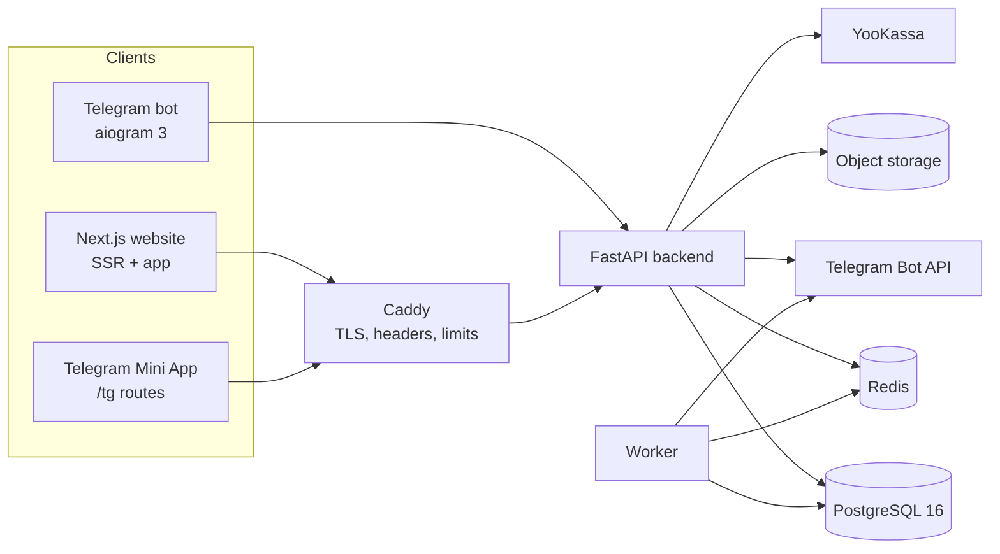

# Architecture

> Status: current implementation. See `IMPLEMENTATION_PLAN.md` for progress and evidence.

## System context



All authoritative state lives in PostgreSQL. Web, Mini App and bot are clients of the same backend
domain/service layer; the bot imports the same services rather than re-implementing rules.

## Monorepo layout

```
backend/
  zooffer/            application package
    api/              FastAPI routers + dependencies
    core/             config, security, errors, logging, rate limits, ids
    db/               session, base, models
    schemas/          request models + public/private response DTOs
    services/         domain logic (auth, listings, swipes, matching, messaging, …)
    workers/          background job entrypoints
  alembic/            migrations
  tests/              unit + integration tests
bot/                  aiogram application (thin)
web/                  Next.js App Router (website + /tg Mini App)
infra/                PostgreSQL init script for the local Compose stack
scripts/              demo seed, local CI launcher and operational helpers
docs/                 product/engineering documentation
```

## Backend layering

- **API** validates input with Pydantic v2, declares permissions, calls services, returns explicit
  response schemas. ORM objects are never serialised directly.
- **Services** own transactions and business invariants (quota, matching, publishing, payments).
- **Repositories/queries** are focused data access helpers; no business rules leak into routers.
- **Public read paths** project to DTOs from allowlisted columns and never join
  `user_private_data`.

## Identity and sessions

A single `users` row is the canonical identity. `auth_identities` maps providers (`password`,
`telegram`) to that user; Telegram identity uses the numeric Telegram user ID, never a username.
Sessions are random 256-bit tokens delivered in an `HttpOnly` cookie; only an HMAC-SHA256 hash is
stored. A session has idle and absolute expiry, is rotated on login and privilege change, and can be
revoked per device. CSRF uses SameSite=Lax plus double-submit token and Origin validation.

## Privacy enforcement

1. Private fields only exist in `user_private_data` / `credentials` / `auth_identities` /
   `payment_*` / `documents` tables.
2. Every public response is an explicit Pydantic model with an allowlisted field set, asserted by a
   contract test.
3. Public identifiers are opaque UUIDs plus transliterated slugs; no internal IDs in URLs or payloads.
4. A canary suite plants unique sentinels in private fields and scans API, HTML, RSC payloads,
   metadata, sitemaps, bot messages and notifications.
5. `owner_display_name` is the only owner identity field in public DTOs (first name + optional
   surname, or `null` → «Владелец»).

## Quotas and matching

`daily_quota_usage` is keyed by `(user_id, quota_date)` where `quota_date` is the local date in
Europe/Moscow. Consuming a swipe runs in one transaction:

```sql
INSERT INTO daily_quota_usage (user_id, quota_date, used_count)
VALUES (:user, :date, 1)
ON CONFLICT (user_id, quota_date)
DO UPDATE SET used_count = daily_quota_usage.used_count + 1
WHERE daily_quota_usage.used_count < :limit
RETURNING used_count;
```

plus a unique `(user_id, target_type, target_id)` swipe constraint and an idempotency key. If the
conditional update returns no row, the swipe is rejected with the next reset time. Matching runs in
the same transaction as the reciprocal-like lookup, with a canonical ordered animal pair and a unique
index, so concurrent likes cannot create duplicate or missing matches.

## Storage and media

A `MediaStorage` protocol has a local-filesystem adapter used in development and tests. Uploads are
sniffed by content, size/dimension limited, re-encoded with Pillow to strip EXIF/GPS and remove
embedded payloads, and written under server-generated keys. An S3-compatible adapter and
short-lived signed URLs for private documents are **not implemented**; production object storage is
blocked (B9), so the current build must not be described as production-ready for media.

## Observability and operations

Structured JSON logs with request/correlation IDs and PII minimisation, Prometheus metrics on a
protected endpoint, `/healthz` and `/readyz`, and self-hosted error tracking or none — no Russian
personal data is sent to foreign SaaS without a documented legal basis. The production target runs
behind Caddy with TLS, HSTS, CSP and request limits; that deployment is not configured yet (B7).
Containers run non-root with read-only filesystems where practical.

## Deliberate non-goals in the first pass

- Native mobile apps (the Mini App covers Telegram mobile use).
- Microservices: a modular monolith keeps transactions simple for quotas/matching/payments.
- Client-side business rules: the client only renders server decisions.
